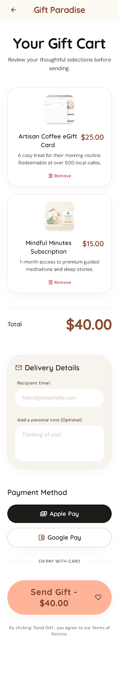

# Cart & Checkout — Digital Gift Paradise 🎁

A modern, responsive, full-stack digital gifting experience built with **React 18, Vite, Tailwind CSS** on the frontend, and a production-ready **Node.js Express & SQLite REST API** on the backend.



---

## 📁 Project Structure

```text
cart_checkout/
├── backend/                  # Node.js + Express + SQLite REST API
│   ├── src/
│   │   ├── config/           # Database & environment configuration
│   │   ├── controllers/      # Cart, Category, Gift, Order, Wishlist controllers
│   │   ├── db/               # SQLite schema (schema.sql) & catalog seed script
│   │   ├── middleware/       # Session ID handler, request logger, error handler
│   │   ├── routes/           # REST API routes
│   │   ├── services/         # Business logic layer
│   │   ├── utils/            # Structured logger, standardized API response
│   │   ├── validators/       # Zod schemas for input validation
│   │   ├── app.js            # Express application factory & security (Helmet, CORS)
│   │   └── server.js         # HTTP server entrypoint & graceful shutdown
│   ├── tests/                # Automated integration tests (node:test)
│   ├── .env.example          # Environment variables template
│   └── package.json
│
├── frontend/                 # React 18 + Vite 5 + Tailwind CSS SPA
│   ├── src/
│   │   ├── api/client.js     # Production-ready API client (configurable via VITE_API_BASE_URL)
│   │   ├── components/       # Header, BottomNav, Toast, CategoryChips, HeroBanner, TrendingGifts
│   │   ├── context/          # GiftContext (state management with offline fallback)
│   │   ├── data/             # Mock data fallbacks
│   │   ├── pages/            # HomePage, CategoriesPage, CustomizePage, CheckoutPage
│   │   ├── App.jsx           # Main application view switcher
│   │   ├── main.jsx          # React DOM entrypoint
│   │   └── index.css         # Compiled Tailwind CSS directives & cozy styling
│   ├── .env.example          # Frontend environment variables template
│   ├── index.html            # Lightweight, SEO-optimized HTML entrypoint
│   ├── tailwind.config.js    # Cozy warm palette & typography tokens
│   ├── postcss.config.js     # PostCSS pipeline for production CSS build
│   ├── vercel.json           # Vercel SPA routing configuration
│   ├── vite.config.js        # Vite dev server with /api reverse proxy
│   └── package.json
│
├── .gitignore                # Production ignore rules (protects .env, node_modules, dist)
└── README.md
```

---

## 🚀 Quick Start (Local Development)

### Prerequisites
- Node.js **>= 22.5.0** (required for native `node:sqlite`)
- npm

### 1. Backend Setup
```bash
cd backend
npm install
npm test          # Run automated test suite
npm run dev       # Start backend server on http://localhost:5000
```
- Health check: `http://localhost:5000/api/health`
- API documentation: `http://localhost:5000/`

### 2. Frontend Setup
```bash
cd frontend
npm install
npm run dev       # Start Vite dev server on http://localhost:3000
```

Open `http://localhost:3000` in your browser. Vite automatically proxies `/api/*` requests to the local backend at `http://localhost:5000`.

---

## 🔒 Security & Environment Variables

### Security Highlights
- **Zero Secrets in Git**: `.gitignore` strictly ignores `.env`, `*.env`, `backend/data/*.db`, and build artifacts.
- **CORS Protection**: Whitelists configured origins, localhost in development, and `*.vercel.app` domains.
- **Input Validation**: All POST/PUT request bodies are validated using Zod schemas.
- **Security Headers**: Integrated Helmet middleware for HTTP security headers.
- **Sanitized Errors**: In production mode (`NODE_ENV=production`), internal stack traces are hidden from API responses.

### Environment Configuration

#### Backend (`backend/.env`)
```env
PORT=5000
NODE_ENV=development
DB_PATH=./data/digital_gift_paradise.db
CORS_ORIGIN=http://localhost:3000,http://localhost:5173
LOG_LEVEL=info
```

#### Frontend (`frontend/.env`)
```env
# Optional in development (defaults to proxied /api or http://localhost:5000/api)
# Set in Vercel to your deployed backend URL:
VITE_API_BASE_URL=https://your-backend-api.onrender.com/api
```

---

## ☁️ Deployment Guide

### Deploy Frontend to Vercel
1. Import the repository on [Vercel](https://vercel.com).
2. Configure project settings:
   - **Root Directory**: `frontend` (or `./` if deploying the frontend repo directly).
   - **Framework Preset**: `Vite`
   - **Build Command**: `npm run build`
   - **Output Directory**: `dist`
3. In **Environment Variables**, add:
   - `VITE_API_BASE_URL`: `https://your-backend-api.onrender.com/api` (URL of your deployed backend)
4. Click **Deploy**. Vercel will build the frontend with `vercel.json` handling SPA routing.

### Deploy Backend to Render / Railway / Fly.io
1. Create a **Web Service** pointing to the repository.
2. Configure settings:
   - **Root Directory**: `backend`
   - **Environment**: `Node` (Node.js >= 22.5.0)
   - **Build Command**: `npm install`
   - **Start Command**: `npm start`
3. In **Environment Variables**, add:
   - `NODE_ENV`: `production`
   - `PORT`: `5000` (or leave default assigned by platform)
   - `CORS_ORIGIN`: `https://your-frontend-app.vercel.app`
   - `DB_PATH`: `./data/digital_gift_paradise.db` (for persistent data on Render/Railway, attach a persistent disk)
4. Deploy and verify status at `https://your-backend-api.onrender.com/api/health`.

---

## 🧪 Testing
Run backend unit and integration tests:
```bash
cd backend
npm test
```
Verifies 17 integration tests across catalog gifts, custom cards, persistent cart, wishlist, and orders checkout.
